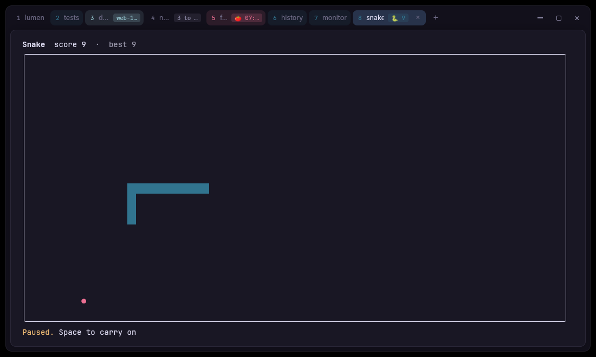

# Lumen

A GPU-rendered terminal for Linux and macOS. It has tabs, split panes, shell
integration, and plugins you can write in any language.

It's a native app, not a webview: no Electron, no browser engine underneath.
Every glyph is drawn straight to the GPU.


## Install

```sh
curl -fsSL https://lumenshell.dev/install | sh
```

It installs for your user, without sudo, on Linux (x86_64 and arm64) and
macOS. Run it again to update.

On macOS you can use Homebrew instead:

```sh
brew install --cask lumenshell/tap/lumen
```

To uninstall, pick a version, or build from source, see
[Installing Lumen](docs/install.md).

## What you get

- **Tabs and split panes.** Drag tabs to reorder them and drag the gaps to
  resize splits. Focus Mode zooms one pane. Every window, tab and split comes
  back next launch.
- **A quick terminal.** It drops down from the top of the screen on one key,
  from any app, and hides again with its shells still running.
  [More](docs/quick-terminal.md)
- **Your shell, understood.** Jump between commands, copy the last command's
  output, and spot failed commands by their red mark. Get a notification when
  a long command finishes while you're elsewhere.
  [More](docs/shell-integration.md)
- **One palette for everything.** Ctrl+Shift+P (⌘⇧P) fuzzy-searches every
  action, theme and plugin command.
- **Select and copy without the mouse.** Move over the screen and scrollback
  with vi keys. [More](docs/keyboard.md#keyboard-select-mode)
- **Scripts that drive it.** `lumen msg` opens tabs and splits, types into
  panes, reads their screens and streams events. [More](docs/scripting.md)
- **Plugins in any language.** Seven come built in, from command history to a
  pomodoro timer. [More](docs/builtin-plugins.md)
- **Themes for the whole window.** Rosé Pine, Rosé Pine Moon, Catppuccin
  Mocha, Tokyo Night and Rosé Pine Dawn recolour the terminal and the chrome
  around it.

It also handles CJK input methods, the kitty keyboard protocol, clickable
links, mouse reporting for vim and tmux, and colour emoji. See
[everything Lumen does](docs/features.md).

## Screenshots

**Tabs with badges and colours**, set by plugins and scripts: a pomodoro
countdown, a staging server, what's left to do.


<table>
<tr>
<td width="50%"><b>Pomodoro Timer</b>, a built-in plugin: a big countdown in a strip under your work, with the time on the tab.<br><br></td>
<td width="50%"><b>Plugin panes</b>: a todo list drawn by a plugin, beside your shell, with what's left on the tab.<br><br></td>
</tr>
<tr>
<td><b>Command palette</b>: every action, theme and plugin command, fuzzy-searched.<br><br></td>
<td><b>Plugin Gallery</b>: the built-in plugins, off until you turn them on.<br><br></td>
</tr>
<tr>
<td><b>Find in scrollback</b>, with every match highlighted.<br><br></td>
<td><b><code>watch_pane.py</code></b>, an example script: <code>watch</code> in a pane of its own, with changes highlighted.<br><br></td>
</tr>
<tr>
<td colspan="2"><b>Snake</b>, an example plugin: a game in a tab of its own, drawn in a plugin pane.<br><br></td>
</tr>
</table>

## The keys to know

| Action              | Linux                | macOS            |
|---------------------|----------------------|------------------|
| Command palette     | Ctrl+Shift+P         | ⌘⇧P              |
| New tab             | Ctrl+T               | ⌘T               |
| Split right / down  | Ctrl+Shift+D / E     | ⌘D / ⌘⇧D         |
| Close pane          | Ctrl+Shift+W         | ⌘W               |
| Move between panes  | Ctrl+Arrows          | ⌘Arrows          |
| Find in scrollback  | Ctrl+Shift+F         | ⌘F               |
| Prev / next command | Ctrl+Shift+↑ / ↓     | ⌘⇧↑ / ⌘⇧↓        |

The rest are in [Keyboard](docs/keyboard.md). You can change any of them in
the config.

## Config

Settings live in `~/.config/lumen/config.toml`. Lumen writes it, with
comments, the first time it runs, and applies your changes the moment you
save.

```toml
theme = "Tokyo Night"
font-size = 14
background-opacity = 0.9

[keys]
ctrl-t = "none"   # give Ctrl+T back to the shell
```

Every setting and key binding is in [Config](docs/config.md).

## Scripting

Inside a Lumen pane, `lumen msg` acts on that pane:

```sh
p=$(lumen msg split right --run 'npm run dev')   # prints the new pane's id
lumen msg tab-style --badge prod --color red
lumen msg watch command-finished                 # events as JSON lines
```

[Scripting](docs/scripting.md) covers every command, the events and the
JSON-RPC protocol. [`examples/`](examples/) has ready-made scripts.

## Plugins

Turn on the built-in plugins from **Plugin Gallery** in the palette. Each one
shows what it does and what it's allowed to do before you approve it.

To write your own in Python, use `lumen_plugin`. It comes with Lumen, so
there's nothing to install:

```python
from lumen_plugin import Plugin

app = Plugin()

@app.command("Switch Git Branch", keys="alt-b")
async def switch(pane):
    branch = await app.pick(["main", "dev"], placeholder="Switch to…")
    if branch:
        await pane.run(["git", "switch", "--", branch])   # a list is quoted for the shell

app.run()
```

- [Built-in plugins](docs/builtin-plugins.md): what each one does
- [Plugin guide](docs/plugins.md): writing plugins in Python
- [Plugin protocol](docs/plugin-protocol.md): writing them in any other language

## Two extras

`lumen info` shows your system beside a flickering flame in your theme's
colours. `lumen campfire` fills a pane with a crackling fire, for cold coding
sessions. See [Commands](docs/commands.md).

## Documentation

| Guide | Covers |
|---|---|
| [Installing Lumen](docs/install.md) | Installer options, Homebrew, release files, building from source |
| [Features](docs/features.md) | Everything Lumen does |
| [Keyboard](docs/keyboard.md) | All shortcuts, the find bar, the palette, keyboard select mode |
| [Config](docs/config.md) | Every setting and key binding |
| [Quick terminal](docs/quick-terminal.md) | Setting it up on X11, Wayland and macOS |
| [Shell integration](docs/shell-integration.md) | What it adds, how it loads, using it over SSH |
| [Commands](docs/commands.md) | `lumen info` and `lumen campfire` |
| [Scripting](docs/scripting.md) | `lumen msg`, events and the socket protocol |
| [Built-in plugins](docs/builtin-plugins.md) | The seven plugins in the Plugin Gallery |
| [Plugin guide](docs/plugins.md) | Writing plugins in Python |
| [Plugin protocol](docs/plugin-protocol.md) | Writing plugins in any language, and permissions |
| [Files and session](docs/files.md) | Where Lumen keeps things, and its environment variables |
| [Working on Lumen](docs/development.md) | Building, tests, source layout, releasing |

## License

Lumen is available under either the [MIT License](LICENSE-MIT) or the
[Apache License 2.0](LICENSE-APACHE), at your option. Unless you say otherwise,
anything you contribute is offered under the same terms.

The bundled fonts, JetBrains Mono and Inter, keep their own license, the SIL
Open Font License ([JetBrains Mono](assets/fonts/JetBrainsMono-OFL.txt),
[Inter](assets/fonts/Inter-LICENSE.txt)).
